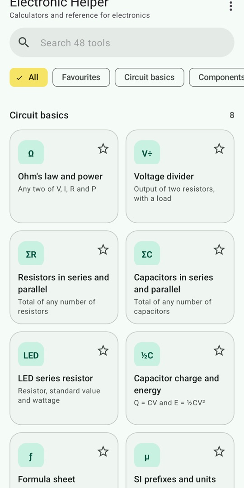
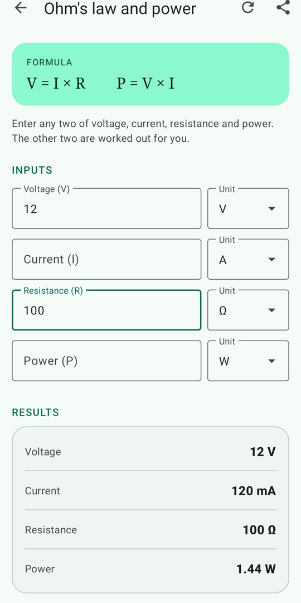
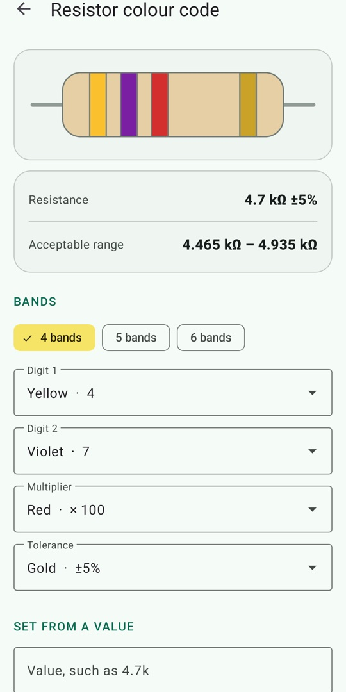
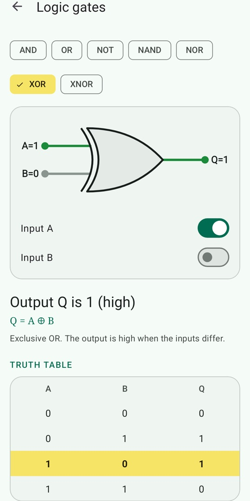

# Electronic Helper

Calculators and reference tables for electronics, in one free Android app. It works offline, shows no
adverts and asks for no permissions.

[Website](https://supunsarachitha.github.io/Electronic_Helper/) ·
[Google Play](https://play.google.com/store/apps/details?id=lk.stechbuzz.electronic) ·
[Privacy policy](https://supunsarachitha.github.io/Electronic_Helper/privacy.html) ·
[Changelog](CHANGELOG.md)

<p>
  
  
  
  
</p>

## What it does

| Category | Tools |
|---|---|
| Circuit basics | Ohm's law and power, voltage divider, resistors and capacitors in series and parallel, LED series resistor, capacitor energy, formula sheet, SI prefixes |
| Components | Resistor colour code (4, 5 and 6 bands), SMD resistor code, capacitor code, standard value finder, LED voltages, transistors, IC pinouts, switch types |
| Signals and timing | RC time constant, RC filter, reactance, LC resonance, 555 astable and monostable, RMS and peak, frequency and wavelength, op-amp gain, decibels, dBm |
| Power and wiring | Battery life, LM317, linear regulator heat, heat sink, wire voltage drop, PCB trace width, wire gauge table, batteries |
| Digital and boards | Logic gate simulator, number base converter, ADC resolution, Arduino boards, Arduino UNO pins, Raspberry Pi GPIO |
| Connectors and mains | USB, coaxial connectors and cables, mains plug types, mains voltage by country |

Calculators update as you type, and every field has a unit picker. Tools are searchable and can be starred
as favourites. The app follows the system light or dark theme.

## Build it

You need the [.NET 10 SDK](https://dotnet.microsoft.com/download), a JDK (17 or 21) and the Android SDK
with platform 36.

```bash
git clone https://github.com/supunsarachitha/Electronic_Helper.git
cd Electronic_Helper
dotnet workload install android

dotnet test                                        # run the unit tests
dotnet build src/ElectronicHelper -t:Install       # build and install on a connected device or emulator
```

If the build cannot find your JDK or Android SDK, point it at them:

```bash
dotnet build src/ElectronicHelper -t:Install \
  -p:JavaSdkDirectory=/path/to/jdk -p:AndroidSdkDirectory=/path/to/android/sdk
```

To produce a signed bundle for Google Play, see [RELEASING.md](RELEASING.md).

## How the code is organised

```
src/ElectronicHelper.Core/     Formulas, component decoders and reference data. Plain .NET, no Android.
src/ElectronicHelper/          The Android app: five screens that render what Core describes.
tests/ElectronicHelper.Core.Tests/   Unit tests for Core.
docs/                          The website, served by GitHub Pages.
store/                         Play Store listing text, icon, feature graphic and screenshots.
```

The app keeps logic and presentation apart. Each calculator is a description in
[CalculatorCatalog.cs](src/ElectronicHelper.Core/CalculatorCatalog.cs): its fields, its formula and a
function from inputs to result lines. One screen, `CalculatorActivity`, renders all of them. Reference pages
work the same way through [ReferenceCatalog](src/ElectronicHelper.Core/Reference.cs) and `ReferenceActivity`.

### Add a calculator

1. Put the maths in [Formulas.cs](src/ElectronicHelper.Core/Formulas.cs) and test it against a known answer.
2. Describe the calculator in `CalculatorCatalog.cs` and add it to `All`.
3. List it in [ToolCatalog.cs](src/ElectronicHelper.Core/ToolCatalog.cs) with the same ID.

No Android code is needed. The catalogue tests fail if a tool points at a calculator that does not exist, or
if a calculator misbehaves on empty or zero input.

## Contributing

Bug reports and pull requests are welcome. Please run `dotnet test` before opening a pull request, and cite
a source for any reference data you add or change.

## Accuracy

Results and reference values are a guide. Component ratings and pin orders vary between manufacturers, and
mains supplies vary by region. Check the datasheet, and follow local wiring regulations, before building
anything that matters.

Arduino and Raspberry Pi are trademarks of their respective owners. This project is not affiliated with or
endorsed by them.

## Licence

[MIT](LICENSE) © Supun Sarachitha
